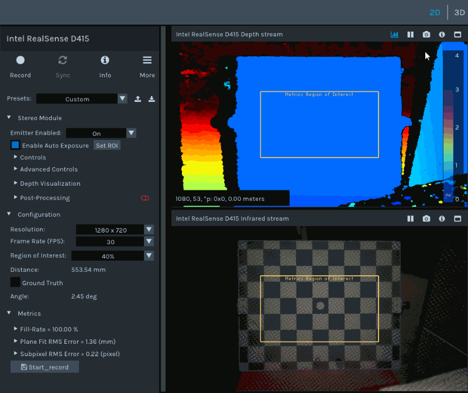

The Depth Quality Tool (`rs-depth-quality`) is a graphical application that streams depth from a RealSense camera pointed at a flat surface, fits a plane to the depth inside a region of interest (ROI) and computes depth quality metrics live: fill rate, Z accuracy against a measured ground truth, plane fit RMS error (spatial noise), subpixel RMS error and temporal noise. Use it to evaluate depth performance of a camera and its settings, and to record metrics and raw frames for offline analysis.



The source is in [`tools/depth-quality`](https://github.com/realsenseai/librealsense/blob/development/tools/depth-quality): the entry point and metric formulas in [`rs-depth-quality.cpp`](https://github.com/realsenseai/librealsense/blob/development/tools/depth-quality/rs-depth-quality.cpp), the plane fit and per-frame analysis in [`depth-metrics.h`](https://github.com/realsenseai/librealsense/blob/development/tools/depth-quality/depth-metrics.h), and the UI, guidance and recording in [`depth-quality-model.cpp`](https://github.com/realsenseai/librealsense/blob/development/tools/depth-quality/depth-quality-model.cpp).

## Building and launching

The tool is built by CMake target `rs-depth-quality` in [`tools/depth-quality/CMakeLists.txt`](https://github.com/realsenseai/librealsense/blob/development/tools/depth-quality/CMakeLists.txt). It is built only when both of these options are `ON` (both default to `ON` in [`CMake/lrs_options.cmake`](https://github.com/realsenseai/librealsense/blob/development/CMake/lrs_options.cmake)):

| Option | Default | Role |
|---|---|---|
| `BUILD_EXAMPLES` | `ON` | The top-level `CMakeLists.txt` adds the `tools` directory when this is on; [`tools/CMakeLists.txt`](https://github.com/realsenseai/librealsense/blob/development/tools/CMakeLists.txt) adds the graphical tools only inside its `BUILD_EXAMPLES` block. |
| `BUILD_GRAPHICAL_EXAMPLES` | `ON` | Adds `depth-quality` (together with the Viewer and other graphical tools). It turns `BUILD_GLSL_EXTENSIONS` on if it was off. |

`BUILD_TOOLS` does not control this tool: it only adds the non-graphical tools (`convert`, `enumerate-devices`, `fw-logger`, `terminal`, `recorder`, `fw-update`, `embed`, and `dds` when `BUILD_WITH_DDS` is on). See [[Build Configuration]] for all options.

Example configure and build from the repository root:

```sh
mkdir build && cd build
cmake .. -DBUILD_EXAMPLES=ON -DBUILD_GRAPHICAL_EXAMPLES=ON
cmake --build . --target rs-depth-quality
```

The target's `install` rule puts the executable in `${CMAKE_INSTALL_BINDIR}`. On Windows it is built as a GUI (`WIN32`) application.

Launch it with a camera connected:

```sh
rs-depth-quality
```

The window title is "Depth Quality Tool". If no device is connected, the tool does not start streaming.

## Command-line options

`rs-depth-quality` parses its command line with `rs2::cli` from [`common/cli.h`](https://github.com/realsenseai/librealsense/blob/development/common/cli.h) and registers no options of its own. The resulting settings are passed to the `rs2::context` it creates.

| Flag | Argument | Description |
|---|---|---|
| `--debug` | none | Turn on librealsense debug logs. Registered only when built with `BUILD_EASYLOGGINGPP` (default `ON`). |
| `--eth` | none | Detect DDS devices, even if disabled in the configuration. Ignored when not built with DDS support. |
| `--eth-only` | none | Use only DDS devices; do not look for USB/MIPI devices. Ignored when not built with DDS support. |
| `--no-eth` | none | Do not detect DDS devices, even if enabled in the configuration. No-op when not built with DDS support. |
| `--domain-id` | `0-232` | Domain ID to use with DDS devices (default `0`). Ignored when not built with DDS support. |
| `-h`, `--help` | none | Display usage information and exit. |
| `--version` | none | Display version information and exit. |
| `--`, `--ignore_rest` | none | Ignore the rest of the labeled arguments after this flag. |

With `BUILD_WITH_DDS` (default `OFF`), `--eth`, `--eth-only` and `--no-eth` are mutually exclusive, `--domain-id` cannot be combined with `--no-eth`, and `--domain-id` outside `[0, 232]` is rejected. See [[Ethernet and DDS Cameras]].

## Measuring depth quality

### What happens at start

On start the tool takes the first connected device and starts a pipeline with the default Depth and Infrared stream profiles. If the device supports D400 advanced mode and advanced mode is off, the tool switches it on ("Toggling device into Advanced Mode..."), except for devices connected over DDS. If the pipeline cannot start, the window shows "Device is not functional or busy!". If the active device is disconnected, the tool stops the pipeline and resets.

The view opens in 3D and shows the fitted plane. The depth colorizer is set to a fixed range of 0.3 m to 2.7 m with histogram equalization off. Metrics are computed only for Depth frames in `Z16` format.

### Step by step

1. Point the camera at a flat wall or surface. Until the tool finds a plane in the ROI it shows "Please point the camera to a flat Wall / Surface!".
2. Align the camera. When the plane angle stays above 10 degrees, the tool shows "Rotate the camera slightly Right / Left / Up / Down" with the hint "Recommended angle: < 3 degrees", and highlights the orientation guide on the right of the view.
3. Set the distance. When the plane distance is below 300 mm or above 2000 mm, the tool shows "Move the camera further Away" or "Move the camera Closer to the wall" with "Recommended distance: 0.3m-2m from the target". The distance guide on the right shows a scale with the 300–2000 mm range in green.
4. Pick the **Region of Interest** size (see below).
5. To get Z accuracy, tick **Ground Truth** and enter the measured distance to the wall in millimeters.
6. Read the metrics in the **Metrics** section. Expand a metric to see its description and a plot of its recent values (the last 200 values).
7. Optionally record metrics and frames with the save button (see [Recording metrics and frames](#recording-metrics-and-frames)).

All messages quoted above are drawn by `tool_model::draw_instructions` in `depth-quality-model.cpp`.

### Control panel

The left panel shows the device controls (the same device panel used by the [[Realsense Viewer Manual]], with the depth sensor only). The tool hides the Enable Max Usable Range and Enable IR Reflectivity options from the generic options list. Loading a JSON file through the device panel restarts the pipeline with the same streams.

Under **Configuration**:

| Control | What it does |
|---|---|
| Resolution / FPS | Changes the depth stream profile. The Infrared stream follows the depth resolution when possible, otherwise it keeps its previous resolution. An unsupported combination shows "Selected configuration is not supported!". |
| Region of Interest | `80%`, `60%`, `40%` (default) or `20%`. The ROI is a rectangle centred in the image, with that fraction of the frame width and height. |
| IR Reflectivity | Shown only when the depth sensor supports `RS2_OPTION_ENABLE_IR_REFLECTIVITY`. It can be enabled only with the 20% ROI; otherwise the tool shows "Please set 'VGA' resolution, 'Max Range' preset and 20% ROI before enabling IR Reflectivity". While it is enabled the ROI cannot be changed ("ROI cannot be changed while IR Reflectivity is enabled"). |
| Distance | Distance from the camera to the fitted plane, in mm. |
| Ground Truth | When ticked, an integer field (mm) with the true distance to the wall. When unticked, the field tracks the current measured distance, so ticking it starts from that value. Z accuracy is computed only while it is ticked and non-zero. |
| Limit Captures | When ticked, a recording stops by itself after this number of samples (minimum and default 1). |
| Angle | Angle between the fitted plane normal and the camera Z axis, in degrees. |

### Recording metrics and frames

The button with the save icon under **Metrics** starts a recording: it opens a save-file dialog and uses the chosen name as the base name. Clicking it again stops the recording.

While recording, for every frameset the metrics thread processes, the tool writes (with `<base>` the chosen name without its last extension and `<n>` the frame number):

- `<base>_Depth_<n>.png`: the colorized depth frame;
- `<base>_<stream>_<n>.raw` and `<base>_<stream>_<n>_metadata.csv` for the Depth and Infrared frames: raw frame data and frame attributes (see [[Frame Metadata]]);
- `<base>_<n>_3d_mesh.ply`: the point cloud, only when a texture source is selected for the 3D view.

When the recording stops, the tool writes:

- `<chosen name>_depth_metrics.csv`: device info (name, product ID, serial number, firmware version), the streaming profiles, the plane fit distance and ground truth (or `N/A`), then one row per sample with the sample index, frame number, timestamp (ms) and one column per metric, plus a `Plane Fit RMS Error mm` column;
- `<chosen name>_configuration.json`: the advanced-mode settings of the device (`serialize_json()`), for devices that support D400 advanced mode (see [[D400 Advanced Mode]]). This file is not written when the recording stops because the **Limit Captures** count was reached.

## How the analysis works

The metrics thread takes the latest depth frame, analyses it, then sleeps 80 ms, so the metrics are updated at most about 12 times per second whatever the stream frame rate.

For each frame ([`analyze_depth_image`](https://github.com/realsenseai/librealsense/blob/development/tools/depth-quality/depth-metrics.h)):

1. Every pixel in the ROI with a non-zero depth value is converted to meters (raw value × depth scale) and deprojected to a 3D point with the depth intrinsics (`rs2_deproject_pixel_to_point`).
2. A plane `a·x + b·y + c·z + d = 0` with a unit normal is fitted to these points by least squares (`plane_from_points`, following the [plane-from-points method](http://www.ilikebigbits.com/blog/2015/3/2/plane-from-points)). At least 3 valid points are needed; otherwise no metrics are computed for the frame.
3. **Distance** = `−d × 1000` (mm): the distance from the camera to the plane along its normal.
4. **Angle** = `acos(|c|)` in degrees.
5. The plane corners at the ROI corners are found by intersecting the pixel rays with the plane; they are drawn in the 3D view and used to decide whether a plane was found.

The stereo baseline used by the subpixel metric is the absolute X translation, in mm, of the extrinsics from the left infrared stream (index 1) to the right infrared stream (index 2) of the depth sensor. If the sensor has no such streams, the baseline is −1, and if the extrinsics are unavailable the tool shows "Extrinsic parameters are not available".

## Metrics reference

Metrics are defined and computed in `main()` of [`rs-depth-quality.cpp`](https://github.com/realsenseai/librealsense/blob/development/tools/depth-quality/rs-depth-quality.cpp). All metrics are computed only for frames where a plane could be fitted to the ROI (step 2 above). Fill rate is shown at all times; the other metrics are computed and shown only while the UI reports a plane as found.

| Metric | Unit | Plot range | Needs plane fit |
|---|---|---|---|
| Fill-Rate | % | 0 to 100 | no |
| Z Accuracy | % | −10 to 10 | yes, and a ground truth |
| Plane Fit RMS Error | % | 0 to 5 | yes |
| Subpixel RMS Error | pixel | 0 to 1 | yes |
| Temporal Noise | % | 0 to 100 | yes |

Notation used below: `N` is the number of ROI pixels with valid depth, `P_i` the deprojected 3D point of pixel `i` (meters), `dist_i = a·x_i + b·y_i + c·z_i + d` its signed distance to the fitted plane, and `Q_i = P_i − dist_i·(a, b, c)` its projection onto the plane.

### Fill-Rate

`Fill-Rate = 100 × N / (ROI width × ROI height)`

The percentage of ROI pixels with a non-zero depth value.

### Outlier removal

Before the plane-fit metrics are computed, the points are sorted by Z and `N / 200` points are removed from each end (the lowest and highest 0.5%). Plane Fit RMS Error, Subpixel RMS Error and Z Accuracy use the remaining `n` points. Temporal noise uses all valid ROI pixels.

### Plane Fit RMS Error

`RMS_mm = sqrt( Σ (1000 × dist_i)² / n )`

`Plane Fit RMS Error = 100 × RMS_mm / Distance_mm`

The RMS of the point-to-plane distances (spatial noise), shown as a percentage of the plane distance. Recordings store both the percentage and `RMS_mm` (column `Plane Fit RMS Error mm`).

### Subpixel RMS Error

`BF = baseline_mm × fx × depth_scale`

`Δ_i = BF / |P_i| − BF / |Q_i|`

`Subpixel RMS Error = sqrt( Σ Δ_i² / n )`

`fx` is the depth focal length in pixels and `|P|` the Euclidean length of the point from the camera. `Δ_i` is the disparity difference between the measured point and its projection onto the plane.

### Z Accuracy

1. The ray through the image centre pixel (`width / 2`, `height / 2` of the depth intrinsics) is intersected with the fitted plane; call its Z coordinate `pivot_z` (meters).
2. `offset_mm = 1000 × pivot_z − GT`, where `GT` is the ground truth in mm.
3. For each point, `err_i = offset_mm + 1000 × dist_i`.
4. `Z Accuracy = 100 × median(err_i) / GT` (the median is the element at index `n / 2` of the sorted errors).

A positive value means the plane fit is further than the ground truth; a negative value means it is in front of it. Z Accuracy is enabled only while **Ground Truth** is ticked with a positive value.

### Temporal Noise

The tool keeps a FIFO of the valid ROI pixels of recent analysed frames in which a plane was reported as found (`NUM_IMAGES = 40`; once the FIFO reaches 40 frames the oldest is dropped, so each computation uses the latest 39 frames). Then, for each ROI pixel:

1. Collect its depth values (mm) over the frames in the FIFO, leaving out frames where it had no depth.
2. `STD(x, y)` = standard deviation of those values (dividing by the number of values), `Median(x, y)` = their median.
3. `Ratio(x, y) = STD(x, y) / Median(x, y)` (0 for pixels with no values).

`Temporal Noise = 100 × median of Ratio over all ROI pixels`

Because the metrics thread sleeps 80 ms after each frame, the frames in the FIFO are not consecutive camera frames.

## See also

- [[Realsense Viewer Manual]]: the Viewer, which shares the device control panel.
- [[D400 Series Visual Presets]]
- [[Command Line Tools]]

<!-- wikigen:footer -->
_Maintained from librealsense `development`; last checked at commit [`65ed974`](https://github.com/realsenseai/librealsense/commit/65ed97469471f9d104969d2b7d029506058819bd)._
<!-- /wikigen:footer -->
